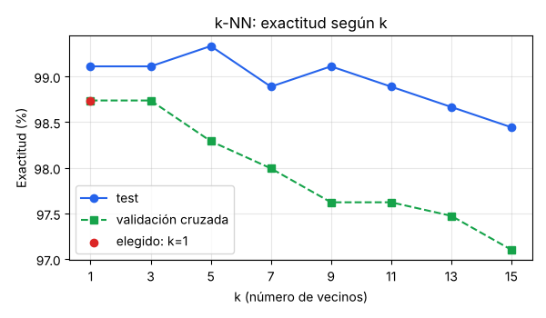
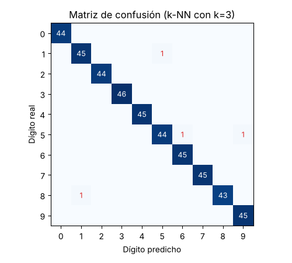
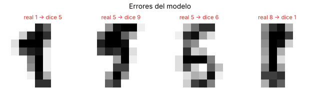
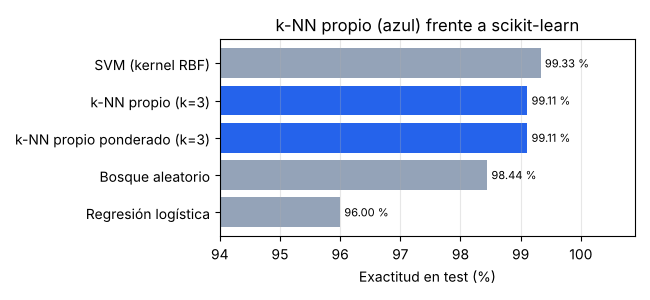

# clasificador-digitos

Clasificador de **dígitos manuscritos (0-9)** con un modelo **k-NN implementado a mano
con numpy**. Le das una imagen de 8×8 píxeles y te dice qué número es. El proyecto recorre
el pipeline completo de un proyecto de IA: **datos → entrenamiento → evaluación → demo**,
y compara el modelo propio con modelos ya hechos de scikit-learn.

Proyecto de 2 días (bloque de IA de la semana). El plan y los hitos están en [PLAN.md](PLAN.md).

## Qué hace el modelo

**k-NN (k vecinos más cercanos)** es probablemente el modelo de IA más fácil de entender:

1. "Entrenar" es simplemente **memorizar** todas las imágenes de ejemplo con su etiqueta.
2. Para clasificar una imagen nueva se calcula su **distancia** a todas las memorizadas
   (cada imagen es un punto con 64 coordenadas, una por píxel; dos imágenes parecidas
   quedan cerca).
3. Se cogen las **k más cercanas** y se hace una **votación**: gana el dígito más repetido.

`k` es un *hiperparámetro*: no lo aprende el modelo, lo elegimos nosotros. Con `k=1`
el modelo se fía de un único vecino (sensible al ruido); con un `k` muy grande opinan
vecinos que ya no se parecen tanto.

Variante **ponderada** (`--ponderado`): cada vecino vota con peso `1/distancia`, así que
un vecino casi idéntico cuenta más que uno que ha entrado entre los k por poco.

## Datos

Dataset `digits` de scikit-learn: 1797 imágenes de 8×8 en escala de grises (no hay que
descargar nada). Se dividen en **75 % entrenamiento (1347)** y **25 % test (450)**, de
forma estratificada y con semilla fija (`42`), así que los resultados son reproducibles.

El conjunto de test son imágenes que el modelo **nunca ha visto**: es la única forma
honesta de medir si ha aprendido a generalizar y no solo a recordar.

## Resultados

Todos los números de esta sección son reales: salen de ejecutar los comandos indicados.

### Elegir k sin hacer trampa (`buscar-k`)

Si probamos muchos valores de `k` y nos quedamos con el que mejor nota saca en el test,
el test deja de ser un examen "nunca visto". La solución es la **validación cruzada**: el
entrenamiento se parte en 5 trozos y, por turnos, cada uno hace de examen de un modelo
entrenado con los otros 4. La nota de cada `k` es la media de los 5 exámenes, y el test
solo se mira al final.

| k | Validación cruzada (5 pliegues) | Test |
|---|---------------------------------|------|
| 1 | **98,74 %** | 99,11 % |
| 3 | **98,74 %** | 99,11 % |
| 5 | 98,29 % | 99,33 % |
| 7 | 97,99 % | 98,89 % |
| 9 | 97,62 % | 99,11 % |
| 11 | 97,62 % | 98,89 % |
| 13 | 97,47 % | 98,67 % |
| 15 | 97,10 % | 98,44 % |



La validación cruzada elige `k=1` (empatado con `k=3`). En el test el mejor habría sido
`k=5`, pero por una sola imagen de diferencia (447 frente a 446 aciertos de 450): eso es
ruido, no una mejora real, y justo por eso no hay que elegir mirando el test. La
tendencia sí es clara en las dos curvas: con este dataset, cuantos más vecinos, peor.

### Informe por clase (`informe`, k=3)

Exactitud en test: **99,11 %** (446 de 450).

| Dígito | Precisión | Recall | F1 | Soporte |
|--------|-----------|--------|----|---------|
| 0 | 100,00 % | 100,00 % | 100,00 % | 44 |
| 1 | 97,83 % | 97,83 % | 97,83 % | 46 |
| 2 | 100,00 % | 100,00 % | 100,00 % | 44 |
| 3 | 100,00 % | 100,00 % | 100,00 % | 46 |
| 4 | 100,00 % | 100,00 % | 100,00 % | 45 |
| 5 | 97,78 % | 95,65 % | 96,70 % | 46 |
| 6 | 97,83 % | 100,00 % | 98,90 % | 45 |
| 7 | 100,00 % | 100,00 % | 100,00 % | 45 |
| 8 | 100,00 % | 97,73 % | 98,85 % | 44 |
| 9 | 97,83 % | 100,00 % | 98,90 % | 45 |
| **media** | 99,13 % | 99,12 % | 99,12 % | 450 |

Qué significa cada métrica:

- **Exactitud (accuracy)**: porcentaje de imágenes de test bien clasificadas.
- **Precisión** de un dígito: de todas las veces que el modelo dijo "es un 5", cuántas
  lo era de verdad. Baja cuando el modelo "ve" ese dígito donde no lo hay.
- **Recall** (exhaustividad): de todos los 5 que había, cuántos encontró. Baja cuando se
  le escapan. El 5 es el dígito más difícil aquí: se le escapan 2 de 46.
- **F1**: media armónica de precisión y recall; solo es alta si las dos lo son.
- **Soporte**: cuántos ejemplos reales de ese dígito hay en el test.
- **Matriz de confusión**: tabla "dígito real × dígito predicho". La diagonal son los
  aciertos; fuera de ella se ve *qué se confunde con qué*.



Los 4 errores, dibujados (un 1 tomado por 5, un 5 por 9, un 5 por 6 y un 8 por 1).
Mirarlos ayuda a entender el modelo: varios son dudosos hasta para una persona.



### Comparación con scikit-learn (`comparar`, k=3)

Mismos datos de entrenamiento y test para todos los modelos:

| Modelo | Exactitud | F1 macro | Fallos (de 450) |
|--------|-----------|----------|-----------------|
| SVM (kernel RBF, C=10) | **99,33 %** | 99,34 % | 3 |
| k-NN propio (k=3) | 99,11 % | 99,12 % | 4 |
| k-NN propio ponderado (k=3) | 99,11 % | 99,12 % | 4 |
| Bosque aleatorio (200 árboles) | 98,44 % | 98,46 % | 7 |
| Regresión logística | 96,00 % | 95,99 % | 18 |



- Un modelo tan simple como k-NN queda a **una sola imagen** del mejor (SVM). En imágenes
  pequeñas y limpias, "parecerse a un ejemplo conocido" funciona muy bien.
- La regresión logística es un modelo **lineal** (traza fronteras rectas entre clases) y
  se queda claramente atrás: los dígitos no se separan del todo con rectas.
- El comando también mide tiempos (varían según la máquina, por eso no están en la
  tabla). El patrón sí se repite: k-NN "entrena" en 0 ms porque solo memoriza, pero es
  el más lento prediciendo, porque compara cada imagen nueva con las 1347 guardadas. Los
  demás modelos hacen lo contrario: trabajan al entrenar y predicen rápido.
- El voto ponderado no cambia nada con k=3 en este test; con k=5 acierta 447 de 450
  (`python main.py evaluar --k 5 --ponderado`).

## Cómo ejecutarlo

```bash
pip install -r requirements.txt

python main.py evaluar --k 3              # exactitud y matriz de confusión
python main.py buscar-k                   # elige k con validación cruzada + gráfica
python main.py informe --k 3              # precisión/recall por clase + gráficas de errores
python main.py comparar                   # k-NN propio frente a scikit-learn + gráfica
python main.py ver --indice 7             # dibuja un dígito de test y lo clasifica
python main.py dibujar ejemplos/siete.txt # clasifica un dígito dibujado por ti

python -m pytest                          # 51 tests
```

`evaluar`, `informe`, `ver` y `dibujar` aceptan `--k N` y `--ponderado`.

### Demo: dibuja tu propio dígito

Crea un fichero de texto de 8 líneas × 8 caracteres. `.` o espacio es papel en blanco y
`#` es tinta; para grises puedes usar números del `0` (nada) al `9` (máximo). En
`ejemplos/` hay cinco dibujos hechos a mano. Por ejemplo, `ejemplos/siete.txt`:

```
.######.
.....##.
....##..
...##...
..####..
...#....
..##....
..#.....
```

```
$ python main.py dibujar ejemplos/siete.txt
  @@@@@@@@@@@@  
          @@@@  
        @@@@    
      @@@@      
    @@@@@@@@    
      @@        
    @@@@        
    @@          

El modelo cree que es un: 7

Votos de los 3 vecinos más cercanos:
  7: ██████████ 100%
Vecinos: 7 (dist. 2.28), 7 (dist. 2.43), 7 (dist. 2.47)
```

También puedes sacar un dígito real del test a un fichero, retocarlo y ver cuándo
cambia de opinión el modelo:

```bash
python main.py ver --indice 7 --guardar mi_digito.txt
# ...edita mi_digito.txt...
python main.py dibujar mi_digito.txt
```

> Limitación honesta: el modelo solo conoce dígitos escritos como los del dataset
> (centrados, trazo grueso, con grises). Un dibujo con trazo fino o descentrado puede
> fallar aunque para ti sea evidente: los modelos aprenden de sus datos, y lo que no se
> parece a ellos les cuesta.

## Estructura

```
main.py              CLI (evaluar, buscar-k, informe, comparar, ver, dibujar)
digitos/
  datos.py           carga, normalización y división train/test estratificada
  knn.py             k-NN desde cero (distancias vectorizadas, voto simple o ponderado)
  metricas.py        exactitud, matriz de confusión, precisión/recall/F1 por clase
  validacion.py      validación cruzada estratificada hecha a mano
  comparar.py        comparación con regresión logística, SVM y bosque aleatorio
  dibujo.py          lee/escribe dígitos 8×8 en ficheros de texto
  visual.py          dígitos en ASCII y gráficas PNG
ejemplos/            dígitos dibujados a mano para la demo
graficas/            gráficas generadas por los comandos
tests/               51 tests con pytest (varios comparan con scikit-learn)
```

## Qué se aprende

1. **Cómo funciona un modelo por dentro**: k-NN no tiene magia; son distancias y una
   votación. Implementarlo con numpy enseña además a **vectorizar** (calcular todas las
   distancias con operaciones de matrices en vez de bucles).
2. **Train/test y validación cruzada**: por qué se evalúa con datos que el modelo no ha
   visto, y por qué los hiperparámetros se eligen con validación y no con el test.
3. **Métricas más allá de la exactitud**: precisión, recall, F1 y matriz de confusión
   dicen *dónde* falla el modelo, no solo cuánto.
4. **Comparar modelos de forma justa**: mismos datos, mismas métricas, semillas fijas; y
   comprobar la implementación propia contra una de referencia (scikit-learn) en los tests.
5. **Los modelos dependen de sus datos**: mirar los errores uno a uno y probar con
   dibujos propios enseña los límites del modelo mejor que cualquier número.
