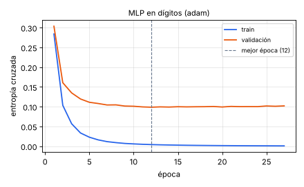
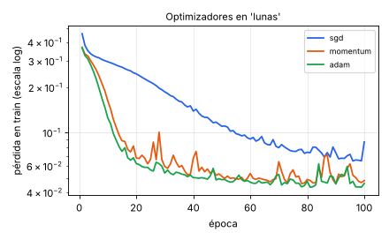
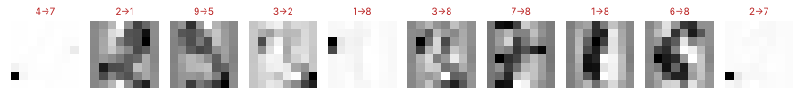
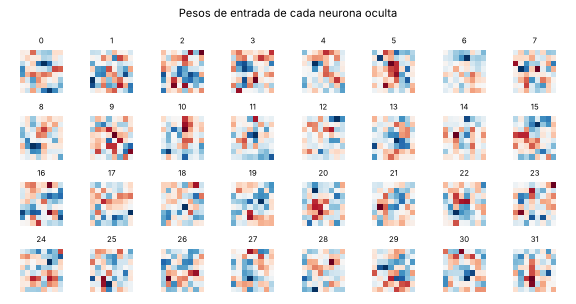
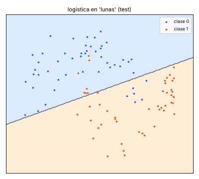
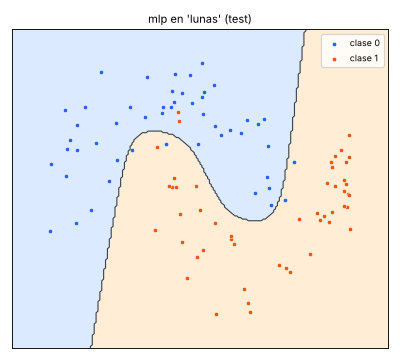

# red-neuronal-numpy ✅

Redes neuronales **desde cero con numpy**: del perceptrón de una sola neurona a una red
multicapa con backpropagation, sin PyTorch ni TensorFlow, para entender qué pasa por dentro.

> Proyecto terminado (bloque de IA, 19-22 nov 2026, 4 días). Ver [PLAN.md](PLAN.md).

## Qué hace

Una herramienta de terminal (`main.py`) con la que se entrena, evalúa, compara, guarda y
usa una red neuronal implementada línea a línea con numpy:

1. **Una sola neurona** (perceptrón, regresión logística) y por qué no basta.
2. **Red multicapa (MLP)** con backpropagation escrito a mano y comprobado numéricamente.
3. **Entrenar mejor**: optimizadores SGD/momentum/Adam, inicialización de pesos,
   validación con parada temprana y softmax para 10 clases (dígitos 8×8, **97.11 %** en test).
4. **Usar el modelo**: guardarlo en un `.npz`, cargarlo para predecir puntos nuevos o
   dígitos dibujados en un fichero de texto, y compararlo con `MLPClassifier` de scikit-learn.

## Conceptos, día a día

### Una sola neurona (día 1)

- **Perceptrón** (Rosenblatt): calcula `z = x·w + b` y predice 1 si `z ≥ 0`. Solo aprende
  cuando se equivoca: mueve la recta hacia el ejemplo mal clasificado.
- **Regresión logística**: la misma neurona, pero con activación **sigmoide**
  `σ(z) = 1/(1+e^-z)`, que da una probabilidad. Se entrena con **descenso de gradiente**
  minimizando la **entropía cruzada**; su gradiente sale sorprendentemente simple: `(p − y)·x`.
  Opcionalmente con regularización **L2** (penaliza pesos grandes).

### Red multicapa con backpropagation (día 2)

Un **MLP** apila capas: `entrada → Densa → activación → … → Densa → sigmoide`.

- **Capa densa**: `z = a·W + b`. Sola sigue siendo lineal; apilar varias densas sin nada
  en medio sigue dando una recta.
- **Activación no lineal** (`tanh`, `relu`, `sigmoide`) entre capas: es lo que permite
  doblar la frontera. Cada neurona oculta aporta un "pliegue".
- **Backpropagation**: la regla de la cadena aplicada de la salida hacia la entrada. Cada
  capa guarda en el *forward* lo que necesita (su entrada o su `z`) y en el *backward*
  recibe `dL/dsalida` y devuelve `dL/dentrada`:
  - densa: `dW = aᵀ·dz`, `db = Σ dz`, `da = dz·Wᵀ`
  - activación: `dz = da · f'(z)`
  - salida (sigmoide + entropía cruzada): `dz = (p − y) / n`
- **Mini-lotes**: en cada época se barajan los datos y se actualizan los pesos cada 32
  ejemplos, en vez de una vez por época.
- **Comprobación de gradientes**: se compara backprop con la derivada numérica
  `(L(θ+ε) − L(θ−ε)) / 2ε`. Si el error relativo es < 1e-6, backprop está bien hecho.
  (Con ReLU hay que evitar caer justo en `z = 0`, donde no tiene derivada.)

### Entrenar mejor (día 3)

- **Optimizadores** (`red/optimizadores.py`): cómo se usa el gradiente para mover los pesos.
  - **SGD**: `θ ← θ − η·g`. Avanza despacio por "valles" alargados.
  - **Momentum**: `v ← β·v − η·g; θ ← θ + v`. Acumula inercia como una bola rodando:
    acelera en la dirección buena y amortigua los zigzags.
  - **Adam**: media del gradiente (momentum) dividida por la raíz de la media de `g²`,
    así cada peso tiene su propio tamaño de paso. Corrige el sesgo de esas medias, que
    empiezan en 0 (por eso su primer paso mide justo `η`).
- **Inicialización de pesos**: la desviación típica inicial decide si la señal sobrevive
  al cruzar muchas capas. `lecun` = `√(1/n_entrada)`, `xavier` = `√(2/(n_ent+n_sal))`
  (pensada para tanh/sigmoide), `he` = `√(2/n_entrada)` (para ReLU, que anula la mitad de
  la señal) y `pequena` = 0.01 (para ver qué pasa si se hace mal).
- **Validación y parada temprana**: se aparta un 20-25 % de train (estratificado) que el
  modelo no usa para aprender. Si la pérdida de validación lleva `paciencia` épocas sin
  mejorar, se para y se **restauran los pesos de la mejor época**: es el momento en que
  el modelo empieza a memorizar train en vez de generalizar.
- **Softmax multiclase**: con k > 2 clases la red tiene k salidas y `softmax` las
  convierte en probabilidades que suman 1. Se entrena con **entropía cruzada categórica**
  `−log P[clase real]`, y el gradiente de salida vuelve a ser `(P − Y_onehot) / n`: la
  misma fórmula que sigmoide + entropía binaria.
- **Dataset `digits`**: 1797 imágenes 8×8 de dígitos manuscritos (64 píxeles → 10 clases).

### Usar el modelo (día 4)

- **Guardar/cargar** (`red/persistencia.py`): un modelo entrenado es su "receta"
  (arquitectura e hiperparámetros, guardados como JSON) + sus pesos `W`, `b` + **la
  estandarización de train** (media y desviación). Todo va a un `.npz` comprimido
  (~5 KB el de lunas, ~21 KB el de dígitos) y se carga con `allow_pickle=False`, así
  que abrir un modelo no puede ejecutar código.
- **Por qué guardar la estandarización**: la red aprendió con datos centrados en 0 y
  con desviación 1. Si al predecir se le pasan los píxeles 0-16 tal cual, recibe números
  en otra escala y responde cualquier cosa. El preprocesado es parte del modelo.
- **Predecir con datos nuevos** (`predecir`): puntos 2D en coordenadas originales o
  dígitos dibujados en texto (8 líneas × 8 caracteres, de claro a oscuro `" .:-=+*#%@"`).
- **Comparación con scikit-learn** (`sklearn`): misma arquitectura y optimizador en
  `MLPClassifier`; si el nuestro estuviera mal, se notaría aquí.

Datasets 2D generados por código: `blobs` (separable con una recta), `lunas`,
`circulos` y `xor` (no separables con una recta).

## Cómo ejecutarlo

```bash
cd 2026-11-19-red-neuronal-numpy
pip install -r requirements.txt

python main.py datos                                   # lista de datasets
python main.py entrenar --modelo perceptron --dataset blobs
python main.py entrenar --modelo logistica --dataset lunas --graficas
python main.py entrenar --modelo mlp --dataset xor --ocultas 16,16 --activacion tanh --graficas
python main.py comparar                                # tabla modelo × dataset
python main.py capacidad --dataset circulos            # exactitud vs. neuronas ocultas
python main.py gradientes --activacion relu            # backprop vs. gradiente numérico
python main.py optimizadores --graficas                # SGD vs. momentum vs. Adam
python main.py inicializacion --activacion relu        # pesos iniciales en una red profunda
python main.py digitos --graficas                      # MLP softmax en dígitos 8×8
python main.py entrenar --modelo mlp --dataset lunas --optimizador adam --validacion 0.2 --paciencia 20

# Guardar un modelo y usarlo después
python main.py entrenar --modelo mlp --dataset lunas --optimizador adam \
       --validacion 0.2 --paciencia 20 --guardar modelos/lunas.npz
python main.py predecir --modelo modelos/lunas.npz --punto 0,1 --punto 1,-0.5
python main.py digitos --guardar modelos/digitos.npz
python main.py predecir --modelo modelos/digitos.npz --indice 3        # imagen de test
python main.py predecir --modelo modelos/digitos.npz --dibujo ejemplos/siete.txt

python main.py sklearn                                 # nuestro MLP vs. MLPClassifier
python -m pytest -q                                    # 102 tests
```

`entrenar` muestra exactitud en train/test, precisión, recall, F1, la matriz de confusión
y la **frontera de decisión dibujada en ASCII**. Con `--graficas` guarda en `graficas/` la
frontera y la curva de aprendizaje como PNG. Opciones del MLP: `--ocultas` (neuronas por
capa, `0` = sin capas ocultas), `--activacion`, `--lote`, `--l2`, `--tasa`, `--epocas`,
`--optimizador` (`sgd`, `momentum`, `adam`), `--init` (`lecun`, `xavier`, `he`, `pequena`),
`--validacion` (fracción de train para validar), `--paciencia` (parada temprana) y
`--guardar` (fichero `.npz`). Los modelos guardados van a `modelos/`, que no se sube al
repo (se regeneran en un par de segundos).

## Resultados reales

Exactitud en test (`python main.py comparar`; 100 ejemplos de test por dataset, ruido 0.2,
semilla 42; MLP `2 → 16 → 16 → 1` con tanh, 500 épocas, lotes de 32, tasa 0.1):

| dataset  | perceptrón | regresión logística | MLP      |
|----------|-----------:|--------------------:|---------:|
| blobs    | 98.00 %    | 99.00 %             | 98.00 %  |
| lunas    | 76.00 %    | 87.00 %             | 94.00 %  |
| circulos | 53.00 %    | 42.00 %             | 99.00 %  |
| xor      | 48.00 %    | 46.00 %             | 99.00 %  |

**Qué significa:** una neurona sola solo puede trazar una **recta**. En `circulos` y `xor`
se queda en ~50 % (tirar una moneda): no existe ninguna recta que los separe. Es la
limitación que Minsky y Papert señalaron en 1969. Con capas ocultas el MLP curva la
frontera y pasa a ~99 %. En `lunas` se queda en 94 % (97.7 % en train): con ruido 0.2 las
dos lunas se solapan y parte de esos fallos son puntos "del otro lado".

**¿Cuántas neuronas hacen falta?** (`python main.py capacidad`, círculos, una capa oculta):

| neuronas ocultas | parámetros | train   | test     |
|-----------------:|-----------:|--------:|---------:|
| 0 (= logística)  | 3          | 54.33 % | 44.00 %  |
| 1                | 5          | 64.00 % | 62.00 %  |
| 2                | 9          | 79.67 % | 72.00 %  |
| 3                | 13         | 98.00 % | 100.00 % |
| 4                | 17         | 98.67 % | 97.00 %  |
| 8                | 33         | 99.33 % | 99.00 %  |
| 16               | 65         | 99.67 % | 99.00 %  |

Con 3 neuronas ya hay tres "rectas" que, combinadas, encierran el círculo interior (un
triángulo). Más neuronas apenas mejoran: el problema no necesita más capacidad.

**Comprobación de gradientes** (`python main.py gradientes`): error relativo máximo entre
1e-12 y 3e-8 para las tres activaciones y redes de 0 a 3 capas ocultas → backprop correcto.

### Optimizadores (día 3)

`python main.py optimizadores` (lunas, MLP `2 → 16 → 16 → 1` tanh, 100 épocas):

| optimizador | tasa | pérdida train época 10 | pérdida train final | exactitud test |
|-------------|-----:|-----------------------:|--------------------:|---------------:|
| SGD         | 0.1  | 0.2972 | 0.0868 | 98.00 % |
| Momentum    | 0.05 | 0.1633 | 0.0480 | 95.00 % |
| Adam        | 0.01 | 0.1257 | 0.0460 | 94.00 % |

Momentum y Adam llegan en 10 épocas a una pérdida que SGD no alcanza hasta la época 35 (la de momentum) o la 46 (la de Adam). Pero
fíjate en la última columna: **menos pérdida en train no es más exactitud en test**. Con
ruido 0.2 las lunas se solapan y los optimizadores rápidos empiezan a ajustarse a ese
ruido. Por eso hace falta un conjunto de validación.

### Inicialización (día 3)

`python main.py inicializacion --activacion relu` (8 capas ocultas de 32, círculos, 30
épocas de SGD). Desviación típica de las activaciones en la capa 1, la del medio y la
última, antes de entrenar:

| inicialización | capa 1 | mitad | última | pérdida tras 30 épocas |
|----------------|-------:|------:|-------:|-----------------------:|
| lecun          | 0.467  | 0.095 | 0.037  | 0.0415 |
| xavier         | 0.160  | 0.032 | 0.013  | 0.0425 |
| he             | 0.660  | 0.535 | 0.592  | **0.0151** |
| pequena (0.01) | 0.007  | 0.000 | 0.000  | 0.6932 (no aprende) |

Con ReLU, `he` es la única que mantiene la señal estable capa tras capa, y es la que más
aprende. Con pesos diminutos la señal (y con ella el gradiente) se apaga y la red se
queda en `log 2 ≈ 0.693`, que es lo que pierde quien responde siempre "50 %".

### Dígitos 8×8 con softmax (día 3)

`python main.py digitos` (MLP `64 → 32 → 10`, ReLU, inicialización He, 2410 parámetros,
20 % de train para validación, paciencia 15). Test = 450 imágenes:

| optimizador | épocas hechas | mejor época | exactitud test |
|-------------|--------------:|------------:|---------------:|
| SGD (0.1)   | 75 | 60 | 96.44 % |
| Momentum (0.05) | 26 | 11 | 95.56 % |
| Adam (0.01) | 27 | 12 | **97.11 %** |

Sin parada temprana (200 épocas, Adam) la exactitud baja a 96.89 % y la pérdida en test
sube de 0.276 a 0.299: el modelo sigue bajando la pérdida de train pero ya no aprende
nada útil. Añadiendo L2 (`--l2 0.001 --paciencia 0`) se llega a 97.11 % con pérdida en
test de 0.161: la regularización evita que se vuelva demasiado seguro de sus fallos.
Los dígitos que más confunde son el 2 (93 %) y algunos 1 que toma por 8.

| Curvas train/validación (dígitos) | Optimizadores (lunas) |
|---|---|
|  |  |

Algunos fallos (real → predicho): 

### Predecir con el modelo guardado (día 4)

`python main.py predecir --modelo modelos/lunas.npz --punto 0,1 --punto 1,-0.5 --punto 0.5,0.25 --punto 2,0.3`
(MLP de lunas con Adam y parada temprana, 95 % en test):

```
  (+0.00, +1.00) -> clase 0  P(clase 1) = 0.001
  (+1.00, -0.50) -> clase 1  P(clase 1) = 0.997 ████████████████████
  (+0.50, +0.25) -> clase 0  P(clase 1) = 0.271 █████
  (+2.00, +0.30) -> clase 1  P(clase 1) = 0.998 ████████████████████
```

El punto `(0.5, 0.25)` cae entre las dos lunas y el modelo lo nota: 27 % en vez de 0 % o 100 %.

`python main.py predecir --modelo modelos/digitos.npz --dibujo ejemplos/siete.txt`:

```
  @@@@@
     @@
    @@
  @@@@@
   @@
   @@
  @@
  @@

Predicción: 7  (confianza 96.7 %)
```

Resultados con los dibujos de `ejemplos/`: `siete.txt` → 7 (96.7 %), `uno.txt` → 1
(95.5 %), `cero.txt` → 0 (98.4 %)... y `siete_sin_barra.txt` → **3 (99.3 %)**. Ese 7
dibujado sin la barra del medio y con un trazo muy grueso arriba no se parece a los 7 del
dataset (casi todos llevan barra) y la red, además de fallar, lo hace **muy segura**.
Es la lección más importante del día: un modelo solo sabe de los datos que ha visto, y
su "confianza" no avisa cuando le llega algo distinto (*cambio de distribución*).

### Comparación con scikit-learn (día 4)

`python main.py sklearn` (Adam, tasa 0.01, lotes de 32, 200 épocas; en dígitos ambos
con 20 % de validación y paciencia 15):

| dataset  | arquitectura | numpy (este proyecto) | `MLPClassifier` |
|----------|--------------|----------------------:|----------------:|
| blobs    | 2-16-16-1    | 98.00 %  | 98.00 % |
| lunas    | 2-16-16-1    | 95.00 %  | 94.00 % |
| circulos | 2-16-16-1    | 99.00 %  | 99.00 % |
| xor      | 2-16-16-1    | 100.00 % | 99.00 % |
| digitos  | 64-32-10     | 97.11 %  | 97.78 % |

Diferencias de ±1 punto (1 de 100 puntos de test, o 3 de 450 dígitos), que vienen de la
inicialización aleatoria, el orden de los mini-lotes y que la parada temprana de
scikit-learn vigila la exactitud y la nuestra la pérdida. En tiempo también van a la par
(0.2-0.5 s por modelo): con redes tan pequeñas numpy basta y sobra.

### Qué aprende cada neurona oculta (día 4)

`python main.py digitos --graficas` guarda también los pesos de entrada de las 32
neuronas ocultas, cada uno como una imagen 8×8 (rojo = ese píxel activa la neurona,
azul = la apaga). No salen "plantillas" de dígitos limpias: cada neurona mira una mezcla
de zonas y trazos, y es la **combinación** de todas en la capa de salida la que decide.



### Fronteras de decisión

| Regresión logística (lunas) | MLP (lunas) | MLP (xor) |
|---|---|---|
|  |  |  |

## Métricas usadas

- **Exactitud**: % de aciertos.
- **Precisión**: de los que el modelo dice "clase 1", cuántos lo son.
- **Recall**: de los que son "clase 1", cuántos encuentra.
- **F1**: media armónica de precisión y recall.
- **Entropía cruzada (log-loss)**: la pérdida que se minimiza; castiga mucho estar
  muy seguro y equivocarse. En multiclase es `−log P[clase real]` de media.
- **Matriz de confusión 10×10**: fila = dígito real, columna = dígito predicho; lo que
  queda fuera de la diagonal son las confusiones.

## Estructura

```
main.py            CLI (datos, entrenar, comparar, capacidad, gradientes,
                   optimizadores, inicializacion, digitos, predecir, sklearn)
red/datos.py       datasets 2D y digits, división estratificada, estandarización,
                   dígitos dibujados en texto
red/persistencia.py  guardar/cargar modelos en .npz (pesos + receta + estandarización)
red/lineales.py    perceptrón, regresión logística, sigmoide estable
red/mlp.py         capas Densa y Activacion, inicializaciones, MLP binario/softmax con
                   validación y parada temprana, comprobación de gradientes
red/optimizadores.py  SGD, Momentum y Adam
red/metricas.py    exactitud, matrices de confusión, precisión/recall/F1, log-loss
red/visual.py      frontera de decisión (PNG y ASCII), curvas, dígitos, pesos
tests/             102 tests con pytest (incluye comprobación numérica del gradiente)
ejemplos/          dígitos dibujados en texto para probar `predecir --dibujo`
graficas/          PNG generados
```

## Qué se aprende

1. **Por qué hacen falta capas ocultas**: una neurona solo traza rectas (≈50 % en XOR y
   círculos); con una capa oculta no lineal la frontera se curva (≈99 %).
2. **Backpropagation es la regla de la cadena**: cada capa recibe `dL/dsalida` y devuelve
   `dL/dentrada`; y se puede (y se debe) comprobar con diferencias finitas.
3. **Entrenar bien importa tanto como la arquitectura**: optimizador (Adam/momentum),
   inicialización acorde a la activación (He para ReLU) y parada temprana con un
   conjunto de validación para no sobreajustar.
4. **Softmax + entropía cruzada** generalizan la regresión logística a k clases con el
   mismo gradiente `(P − Y) / n`.
5. **Un modelo es pesos + preprocesado**, y su confianza no garantiza nada fuera de la
   distribución de entrenamiento (el 7 sin barra que la red ve como un 3 al 99 %).
