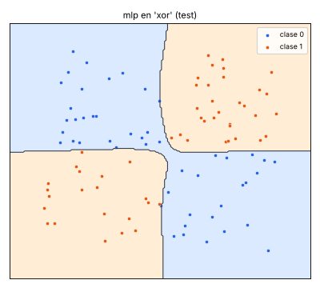

# red-neuronal-numpy 🚧

Redes neuronales **desde cero con numpy**: del perceptrón de una sola neurona a una red
multicapa con backpropagation, sin PyTorch ni TensorFlow, para entender qué pasa por dentro.

> Proyecto en curso (bloque de IA, 19-22 nov 2026). Ver [PLAN.md](PLAN.md).

## Estado actual (día 2/4)

### Una sola neurona (día 1)

- **Perceptrón** (Rosenblatt): calcula `z = x·w + b` y predice 1 si `z ≥ 0`. Solo aprende
  cuando se equivoca: mueve la recta hacia el ejemplo mal clasificado.
- **Regresión logística**: la misma neurona, pero con activación **sigmoide**
  `σ(z) = 1/(1+e^-z)`, que da una probabilidad. Se entrena con **descenso de gradiente**
  minimizando la **entropía cruzada**; su gradiente sale sorprendentemente simple: `(p − y)·x`.
  Opcionalmente con regularización **L2** (penaliza pesos grandes).

### Red multicapa con backpropagation (día 2)

Un **MLP** apila capas: `entrada → Densa → activación → … → Densa → sigmoide`.

- **Capa densa**: `z = a·W + b`. Sola sigue siendo lineal; apilar varias densas sin nada
  en medio sigue dando una recta.
- **Activación no lineal** (`tanh`, `relu`, `sigmoide`) entre capas: es lo que permite
  doblar la frontera. Cada neurona oculta aporta un "pliegue".
- **Backpropagation**: la regla de la cadena aplicada de la salida hacia la entrada. Cada
  capa guarda en el *forward* lo que necesita (su entrada o su `z`) y en el *backward*
  recibe `dL/dsalida` y devuelve `dL/dentrada`:
  - densa: `dW = aᵀ·dz`, `db = Σ dz`, `da = dz·Wᵀ`
  - activación: `dz = da · f'(z)`
  - salida (sigmoide + entropía cruzada): `dz = (p − y) / n`
- **Mini-lotes**: en cada época se barajan los datos y se actualizan los pesos cada 32
  ejemplos, en vez de una vez por época.
- **Comprobación de gradientes**: se compara backprop con la derivada numérica
  `(L(θ+ε) − L(θ−ε)) / 2ε`. Si el error relativo es < 1e-6, backprop está bien hecho.
  (Con ReLU hay que evitar caer justo en `z = 0`, donde no tiene derivada.)

Datasets 2D generados por código: `blobs` (separable con una recta), `lunas`,
`circulos` y `xor` (no separables con una recta).

## Cómo ejecutarlo

```bash
cd 2026-11-19-red-neuronal-numpy
pip install -r requirements.txt

python main.py datos                                   # lista de datasets
python main.py entrenar --modelo perceptron --dataset blobs
python main.py entrenar --modelo logistica --dataset lunas --graficas
python main.py entrenar --modelo mlp --dataset xor --ocultas 16,16 --activacion tanh --graficas
python main.py comparar                                # tabla modelo × dataset
python main.py capacidad --dataset circulos            # exactitud vs. neuronas ocultas
python main.py gradientes --activacion relu            # backprop vs. gradiente numérico
python -m pytest -q                                    # tests
```

`entrenar` muestra exactitud en train/test, precisión, recall, F1, la matriz de confusión
y la **frontera de decisión dibujada en ASCII**. Con `--graficas` guarda en `graficas/` la
frontera y la curva de aprendizaje como PNG. Opciones del MLP: `--ocultas` (neuronas por
capa, `0` = sin capas ocultas), `--activacion`, `--lote`, `--l2`, `--tasa`, `--epocas`.

## Resultados reales

Exactitud en test (`python main.py comparar`; 100 ejemplos de test por dataset, ruido 0.2,
semilla 42; MLP `2 → 16 → 16 → 1` con tanh, 500 épocas, lotes de 32, tasa 0.1):

| dataset  | perceptrón | regresión logística | MLP      |
|----------|-----------:|--------------------:|---------:|
| blobs    | 98.00 %    | 99.00 %             | 98.00 %  |
| lunas    | 76.00 %    | 87.00 %             | 94.00 %  |
| circulos | 53.00 %    | 42.00 %             | 99.00 %  |
| xor      | 48.00 %    | 46.00 %             | 99.00 %  |

**Qué significa:** una neurona sola solo puede trazar una **recta**. En `circulos` y `xor`
se queda en ~50 % (tirar una moneda): no existe ninguna recta que los separe. Es la
limitación que Minsky y Papert señalaron en 1969. Con capas ocultas el MLP curva la
frontera y pasa a ~99 %. En `lunas` se queda en 94 % (97.7 % en train): con ruido 0.2 las
dos lunas se solapan y parte de esos fallos son puntos "del otro lado".

**¿Cuántas neuronas hacen falta?** (`python main.py capacidad`, círculos, una capa oculta):

| neuronas ocultas | parámetros | train   | test     |
|-----------------:|-----------:|--------:|---------:|
| 0 (= logística)  | 3          | 54.33 % | 44.00 %  |
| 1                | 5          | 64.00 % | 62.00 %  |
| 2                | 9          | 79.67 % | 72.00 %  |
| 3                | 13         | 98.00 % | 100.00 % |
| 4                | 17         | 98.67 % | 97.00 %  |
| 8                | 33         | 99.33 % | 99.00 %  |
| 16               | 65         | 99.67 % | 99.00 %  |

Con 3 neuronas ya hay tres "rectas" que, combinadas, encierran el círculo interior (un
triángulo). Más neuronas apenas mejoran: el problema no necesita más capacidad.

**Comprobación de gradientes** (`python main.py gradientes`): error relativo máximo entre
1e-12 y 3e-8 para las tres activaciones y redes de 0 a 3 capas ocultas → backprop correcto.

| Regresión logística (lunas) | MLP (lunas) | MLP (xor) |
|---|---|---|
|  |  |  |

## Métricas usadas

- **Exactitud**: % de aciertos.
- **Precisión**: de los que el modelo dice "clase 1", cuántos lo son.
- **Recall**: de los que son "clase 1", cuántos encuentra.
- **F1**: media armónica de precisión y recall.
- **Entropía cruzada (log-loss)**: la pérdida que se minimiza; castiga mucho estar
  muy seguro y equivocarse.

## Estructura

```
main.py            CLI (datos, entrenar, comparar, capacidad, gradientes)
red/datos.py       datasets 2D, división estratificada, estandarización
red/lineales.py    perceptrón, regresión logística, sigmoide estable
red/mlp.py         capas Densa y Activacion, MLP con backprop, comprobación de gradientes
red/metricas.py    exactitud, matriz de confusión, precisión/recall/F1, log-loss
red/visual.py      frontera de decisión (PNG y ASCII), curvas de aprendizaje
tests/             49 tests con pytest (incluye comprobación numérica del gradiente)
graficas/          PNG generados
```
