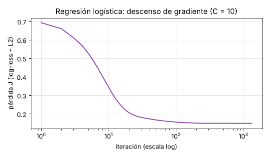
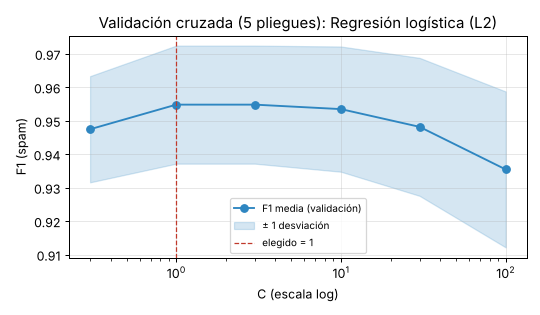
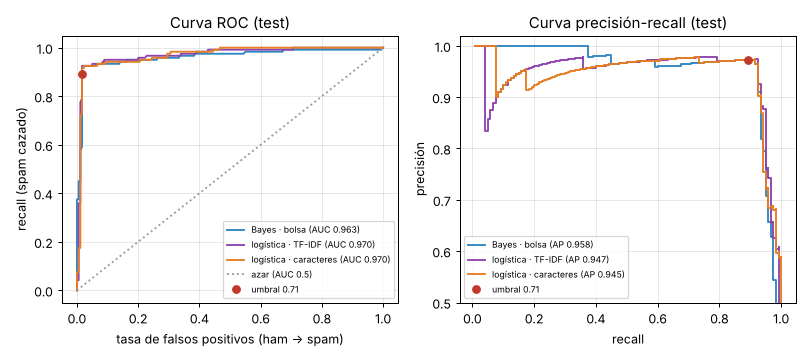

# detector-spam 🚧

Detector de SMS de spam en español construido **desde cero**: preprocesado de texto,
bolsa de palabras, n-gramas, TF-IDF, Naive Bayes y regresión logística escritos a mano
con numpy (y comprobados contra scikit-learn). Es el proyecto de IA de la
semana (jueves a domingo); el plan día a día está en [PLAN.md](PLAN.md).

> Estado: **día 3 de 4**. Funciona de extremo a extremo (generar datos → entrenar →
> evaluar → clasificar mensajes nuevos) con 4 representaciones del texto × 2 modelos,
> validación cruzada, curvas ROC/PR, ajuste del umbral y explicación de predicciones.

## Cómo ejecutarlo

```bash
pip install -r requirements.txt

python main.py generar            # crea datos/mensajes.csv (ya viene incluido)
python main.py datos              # resumen del dataset y ejemplos
python main.py evaluar --grafica  # entrena con train, evalúa en test y guarda un PNG
python main.py predecir "ENHORABUENA has ganado 1000€, entra en www.premios.com" \
                        "¿Quedamos mañana en el parque?"

# Día 2: otros modelos y representaciones
python main.py evaluar --modelo logistica --repr tfidf --grafica   # curva de pérdida
python main.py predecir --modelo logistica --repr tfidf-caracteres "Has ganadoo un premiio"
python main.py comparar --sklearn --grafica   # tabla 4 representaciones × 2 modelos

# Día 3: evaluar en serio y explicar
python main.py validar --grafica                              # busca alfa con 5 pliegues
python main.py validar --modelo logistica --repr tfidf --grafica   # busca C (~25 s)
python main.py curvas --grafica          # ROC/PR, AUC y ajuste del umbral (~20 s)
python main.py explicar "Hola mamá, este es mi número nuevo"  # ¿qué palabras deciden?
python main.py predecir --umbral 0.7 "Tu paquete está retenido, paga 1,99€ en www.envio.es"

python -m pytest -q               # 57 tests (~30 s)
```

## Cómo funciona

### 1. Datos

`spam/datos.py` genera 1200 SMS (720 ham y 480 spam) a partir de plantillas con huecos
(nombres, sitios, premios, marcas, enlaces, teléfonos…). Para que no sea un problema
de juguete incluye **casos difíciles** (spam que parece una conversación, como el
timo de "hola mamá, este es mi número nuevo", y mensajes normales que hablan de
ofertas o premios), **erratas** aleatorias y un **3 % de etiquetas invertidas**, que
imitan los errores de etiquetado de los datasets reales. Todo con semilla fija.

### 2. Del texto a números

- **Normalizar** (`spam/texto.py`): minúsculas, sin tildes (conservando la ñ), y las
  cosas que cambian mucho pero significan lo mismo se sustituyen por tokens especiales:
  `<url>`, `<tel>`, `<dinero>`, `<num>`. Así "500€" y "20 euros" cuentan como la misma pista.
- **Tokenizar**: separar en palabras, guardar las exclamaciones como `!` y quitar las
  *palabras vacías* (de, la, que, el…), que salen en todos los mensajes y no ayudan.
- **Bolsa de palabras** (`spam/vectorizador.py`): cada mensaje se convierte en un vector
  con el número de veces que aparece cada palabra del vocabulario. El vocabulario se
  aprende **solo con train**, para no hacer trampas con el test.

### 3. Naive Bayes multinomial

`spam/bayes.py` aplica el teorema de Bayes:
P(spam | mensaje) ∝ P(spam) · Π P(palabra | spam)^recuento.
Es *naive* porque supone que las palabras son independientes entre sí (falso, pero
funciona). P(palabra | clase) se calcula contando, con **suavizado de Laplace** (`alfa`)
para que una palabra no vista no deje la probabilidad a 0, y todo se hace con
**logaritmos** para no perder precisión al multiplicar números muy pequeños. Un test
comprueba que da exactamente las mismas probabilidades que `MultinomialNB` de scikit-learn.

### 4. Mejores características (día 2)

`spam/vectorizador.py` amplía la bolsa de palabras:

- **N-gramas de palabras** (`--repr tfidf-bigramas`): además de cada palabra, cada pareja
  de palabras seguidas ("premio gratis"). Recupera algo del orden que la bolsa pierde.
  En la salida se muestran con `·` (`llama·<tel>`).
- **N-gramas de caracteres** (`--repr tfidf-caracteres`): cada palabra se trocea en
  pedazos de 2 a 4 letras con un espacio en los bordes (`gratis` → `·g`, `·gr`, `gra`,
  `rat`…). Una errata como "gratiss" cambia la palabra entera, pero comparte más del
  70 % de sus trozos con "gratis", así que el modelo la sigue reconociendo.
- **TF-IDF**: en vez del recuento bruto, cada término pesa
  `tf · idf`, con `tf = 1 + log(recuento)` (que algo salga 5 veces no es 5 veces más
  señal) e `idf = log((1+n)/(1+df)) + 1` (los términos que salen en casi todos los
  mensajes valen poco; los raros, mucho). Al final cada mensaje se normaliza a longitud 1
  para que los largos no dominen. Un test comprueba que la matriz es idéntica a la de
  `TfidfVectorizer` (diferencia 1e-16).

### 5. Regresión logística con descenso de gradiente (día 2)

`spam/logistica.py`. Naive Bayes *cuenta*; la regresión logística *aprende* un peso por
término: `P(spam) = sigmoide(x·w + b)`. Los pesos se ajustan minimizando la
**entropía cruzada** (castiga estar muy seguro y equivocarse) más una penalización
**L2** `||w||² / (2·C·n)` que evita pesos enormes (sobreajuste). El gradiente es
`Xᵀ(p − y)/n + w/(C·n)` y se baja por él con **momento de Nesterov**; el tamaño del paso
se calcula solo a partir de la curvatura máxima del problema (`1/L`), así no hay que
afinarlo a mano. Un test compara el gradiente con diferencias finitas y otro comprueba
que las probabilidades coinciden con `LogisticRegression` de scikit-learn (diferencia
máxima 1.3e-6, 100 % de predicciones iguales).



### 6. Validación cruzada y búsqueda de hiperparámetros (día 3)

`spam/evaluacion.py`. Con 300 mensajes de test, dos aciertos más o menos mueven la F1
casi un punto: una sola división train/test es una medida con mucho **ruido**. La
**validación cruzada k-fold** parte el train en k trozos (*pliegues*) con la misma
proporción de spam (*estratificados*), entrena k veces dejando fuera uno distinto y
valida con él. Sale una media y una desviación, y cada mensaje del train recibe una
P(spam) de un modelo que no lo vio (*probabilidades fuera de pliegue*).

Con eso se eligen `alfa` (Bayes) y `C` (logística) **sin mirar el test**: si se eligieran
con el test, el test dejaría de ser "datos nuevos" y la nota saldría inflada. A
igualdad de F1 se elige el modelo más sencillo (más suavizado / más regularización).



### 7. Curvas ROC y precisión-recall, y el umbral (día 3)

El modelo no dice "spam/ham": dice P(spam), y el 0.5 es solo un umbral por defecto.
Ordenando los mensajes por puntuación y bajando el umbral poco a poco se obtienen:

- **Curva ROC**: tasa de falsos positivos (ham marcado como spam) frente a recall. Su
  área, el **AUC**, es la probabilidad de que un spam al azar puntúe más que un ham al
  azar (0.5 = moneda al aire, 1 = orden perfecto). Mide lo bien que el modelo *ordena*,
  sin depender del umbral.
- **Curva precisión-recall** y su área, la **precisión media (AP)**. Con clases
  desequilibradas es más sincera que la ROC: la ROC divide los falsos positivos entre
  *todos* los ham, y unos pocos casi no se notan.

Las dos se calculan en una sola pasada (ordenar + sumas acumuladas) y los tests
comprueban que dan exactamente lo mismo que `roc_curve`, `roc_auc_score` y
`average_precision_score` de scikit-learn.

El **umbral** se elige también con las probabilidades de validación: o el que maximiza
la F1, o el que consigue más recall con una precisión mínima ("prefiero que se cuele
algo de spam a perder un mensaje bueno"). Después se comprueba una sola vez en test.

### 8. Explicar una predicción (día 3)

`spam/explicacion.py`. Los dos modelos son lineales en los **log-odds**
(`log P(spam)/P(ham)`): en la logística, `b + Σ xⱼ·wⱼ`; en Naive Bayes,
`log P(spam)/P(ham) + Σ xⱼ·[log P(j|spam) − log P(j|ham)]`. Cada sumando es la
contribución exacta de un término, así que la explicación **no es una aproximación**:
sumando las barras y aplicando la sigmoide sale la P(spam) del modelo (hay un test
que lo comprueba). En el modelo de n-gramas de caracteres los trozos se reparten
entre las palabras donde aparecen para poder leerlo por palabras.

```
$ python main.py explicar "Hola mamá, se me ha roto el móvil, este es mi número nuevo"
«Hola mamá, se me ha roto el móvil, este es mi número nuevo»  →  SPAM
  (punto de partida)       -0.41
  nuevo                    +3.21  ████████████████████████
  hola                     +2.29  █████████████████
  movil                    +1.38  ██████████
  roto                     +1.38  ██████████
  mama                     -1.35  ░░░░░░░░░░
  numero                   +0.68  █████
  = log-odds               +7.18  →  P(spam) = 0.999
```

El modelo ha aprendido el timo de "hola mamá": "nuevo", "móvil" y "roto" pesan mucho
más que "mamá" (que por sí sola apunta a ham). Con el modelo de caracteres, "Has
ganadoo un premiio graatis" sigue siendo spam (P = 0.66) aunque ninguna de esas
palabras exista en el vocabulario: sus trozos sí.

## Resultados (día 1)

`python main.py evaluar` — 900 mensajes de train, 300 de test, vocabulario de 804 palabras, `alfa = 1`:

| Conjunto | Exactitud | Precisión | Recall | F1 |
|----------|-----------|-----------|--------|----|
| train    | 0.966     | 0.966     | 0.947  | 0.957 |
| test     | 0.957     | 0.973     | 0.917  | 0.944 |

Matriz de confusión en test: de 180 mensajes normales, 3 acaban marcados como spam
(falsos positivos); de 120 spam, se escapan 10 (falsos negativos).

**Qué significan:** la *precisión* dice cuántos de los mensajes marcados como spam lo
eran de verdad (lo importante para no perder mensajes buenos); el *recall*, cuánto spam
real se caza; F1 resume las dos. Al revisar los errores se ve que varios son justo las
etiquetas invertidas a propósito (p. ej. "Envía GANAR al 6803…" etiquetado como ham):
el modelo acierta y es la etiqueta la que está mal. Ningún modelo puede llegar al 100 %
con datos ruidosos, y eso es normal.


## Resultados (día 2): representación × modelo

`python main.py comparar --sklearn` — mismo train/test, `alfa = 1`, `C = 10`. La última
columna es la F1 en el **mismo test con 3 erratas extra por mensaje**:

| Representación | Modelo | Términos | Exactitud | Precisión | Recall | F1 | F1 con erratas |
|---|---|---|---|---|---|---|---|
| bolsa | Naive Bayes | 804 | 0.957 | 0.973 | 0.917 | 0.944 | 0.924 |
| bolsa | logística | 804 | 0.957 | 0.973 | 0.917 | 0.944 | 0.893 |
| TF-IDF | Naive Bayes | 804 | 0.957 | 0.973 | 0.917 | 0.944 | 0.924 |
| TF-IDF | logística | 804 | 0.957 | 0.973 | 0.917 | 0.944 | **0.945** |
| TF-IDF + bigramas | Naive Bayes | 2487 | 0.957 | 0.973 | 0.917 | 0.944 | 0.928 |
| TF-IDF + bigramas | logística | 2487 | 0.957 | 0.973 | 0.917 | 0.944 | 0.940 |
| TF-IDF caracteres | Naive Bayes | 4278 | 0.943 | 0.972 | 0.883 | 0.926 | 0.926 |
| TF-IDF caracteres | logística | 4278 | 0.957 | 0.973 | 0.917 | 0.944 | 0.940 |


**Qué se ve:**

- En el test limpio casi todos empatan en F1 = 0.944. No es casualidad: los 13 errores
  que quedan son sobre todo las **etiquetas invertidas a propósito** y spam disfrazado
  de conversación. Hay un "techo" puesto por el ruido de los datos, y cambiar de modelo
  no lo rompe. Lección: antes de complicar el modelo, mira los errores.
- La diferencia aparece con **erratas**: la regresión logística sobre recuentos brutos es
  la que más cae (0.944 → 0.893), porque confía mucho en unas pocas palabras exactas; con
  TF-IDF o con n-gramas de caracteres aguanta casi sin perder nada. Naive Bayes de
  caracteres no pierde nada con las erratas, pero de partida es algo peor (se le escapa
  más spam).
- Más términos no es gratis: los n-gramas de caracteres multiplican por 5 el vocabulario
  y el tiempo de entrenamiento de la logística (~4 s frente a <1 s).

## Resultados (día 3): validación cruzada, curvas y umbral

**Búsqueda de hiperparámetros** (`python main.py validar ...`, 5 pliegues sobre los 900
mensajes de train, F1 media ± desviación):

| Modelo | Valores probados | Mejor | F1 validación | F1 test |
|---|---|---|---|---|
| Naive Bayes · bolsa | alfa 0.01 – 3 | alfa = 1 | 0.953 ± 0.018 | 0.944 |
| Logística · TF-IDF | C 0.3 – 100 | C = 1 | 0.955 ± 0.018 | 0.935 |

La desviación entre pliegues (±0.018) es mayor que casi todas las diferencias entre
valores: Naive Bayes da prácticamente igual con cualquier `alfa` entre 0.1 y 3. En la
logística sí se ve la forma típica de la curva de validación: con `C` muy grande (poca
regularización) la F1 baja a 0.935 porque el modelo empieza a memorizar el train. Que
en test C = 1 saque 0.935 frente al 0.944 de C = 10 entra dentro de ese ruido (son 2
mensajes de 120 spam).

**Curvas** (`python main.py curvas`):

| Configuración | AUC validación | AP validación | AUC test | AP test |
|---|---|---|---|---|
| Naive Bayes · bolsa | 0.958 | 0.940 | 0.963 | 0.958 |
| Logística · TF-IDF | 0.951 | 0.927 | 0.970 | 0.947 |
| Logística · caracteres | 0.958 | 0.944 | 0.970 | 0.945 |



**Ajuste del umbral** (logística · TF-IDF, elegido con validación y medido en test):

| Umbral | Precisión val. | Recall val. | Precisión test | Recall test | FP | FN |
|---|---|---|---|---|---|---|
| 0.1 | 0.781 | 0.950 | 0.877 | 0.950 | 16 | 6 |
| 0.3 | 0.955 | 0.944 | 0.957 | 0.925 | 5 | 9 |
| 0.5 | 0.963 | 0.944 | 0.973 | 0.917 | 3 | 10 |
| 0.706 (máx. F1 / prec. ≥ 0.96) | 0.966 | 0.944 | 0.973 | 0.892 | 3 | 13 |
| 0.9 | 0.957 | 0.733 | 0.979 | 0.775 | 2 | 27 |

**Qué se ve:**

- La precisión **se atasca en ~0.97** por mucho que se suba el umbral. Si se exige
  0.99 (`--precision-min 0.99`), el umbral sube a 0.99 y el recall cae al 1 %: el
  programa avisa. El motivo son las etiquetas invertidas a propósito: hay mensajes
  que son spam clarísimo pero están etiquetados como ham, y el modelo (con razón) les
  da P(spam) ≈ 1. Esos "falsos positivos" no se pueden quitar con ningún umbral.
  En datos reales pasa lo mismo: **el ruido de las etiquetas pone un techo**.
- El umbral óptimo en validación (0.706) no mejora el test respecto a 0.5: con tan
  pocos datos, la diferencia entre ambos es de 3 mensajes. Bajar el umbral a 0.3 caza
  más spam (9 FN en vez de 10) a costa de 2 mensajes buenos más en la carpeta de spam:
  qué conviene depende de qué error le molesta más al usuario.
- Los tres modelos tienen AUC ≈ 0.96-0.97: ordenan los mensajes casi igual de bien.
  Las diferencias de F1 del día 2 eran sobre todo de dónde caía el umbral.

## Estructura

```
main.py               CLI (generar, datos, evaluar, predecir, comparar, validar, curvas, explicar)
spam/texto.py         normalización y tokenización
spam/datos.py         generador del dataset, CSV, división train/test y erratas
spam/vectorizador.py  bolsa de palabras, n-gramas (palabras y caracteres) y TF-IDF
spam/bayes.py         Naive Bayes multinomial
spam/logistica.py     regresión logística con descenso de gradiente y L2
spam/experimentos.py  combinaciones representación × modelo y verificación con sklearn
spam/evaluacion.py    validación cruzada, búsqueda de alfa/C, curvas ROC/PR, AUC y umbral
spam/explicacion.py   desglose exacto de una predicción por término o palabra
spam/metricas.py      matriz de confusión, precisión, recall, F1
datos/mensajes.csv    dataset generado (≈80 KB)
graficas/             PNG generados
tests/                tests con pytest
```

## Próximos pasos

Día 4: guardar/cargar el modelo en JSON, segundo caso de uso (análisis de sentimiento
de reseñas), demo web mínima con `http.server` y README final.
