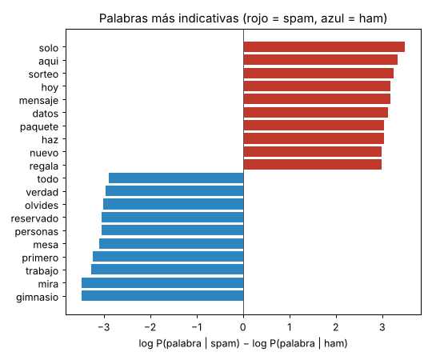
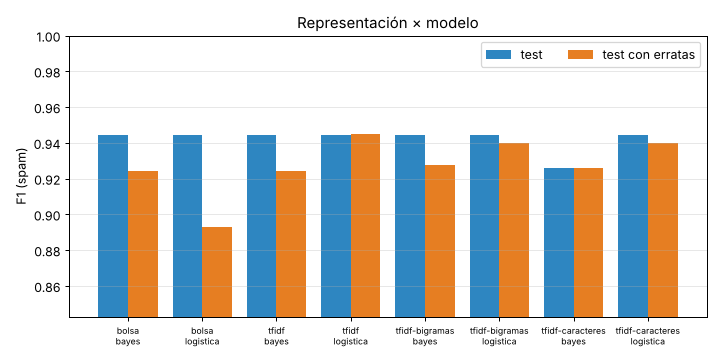

# detector-spam 🚧

Detector de SMS de spam en español construido **desde cero**: preprocesado de texto,
bolsa de palabras, n-gramas, TF-IDF, Naive Bayes y regresión logística escritos a mano
con numpy (y comprobados contra scikit-learn). Es el proyecto de IA de la
semana (jueves a domingo); el plan día a día está en [PLAN.md](PLAN.md).

> Estado: **día 2 de 4**. Funciona de extremo a extremo (generar datos → entrenar →
> evaluar → clasificar mensajes nuevos) con 4 representaciones del texto × 2 modelos.

## Cómo ejecutarlo

```bash
pip install -r requirements.txt

python main.py generar            # crea datos/mensajes.csv (ya viene incluido)
python main.py datos              # resumen del dataset y ejemplos
python main.py evaluar --grafica  # entrena con train, evalúa en test y guarda un PNG
python main.py predecir "ENHORABUENA has ganado 1000€, entra en www.premios.com" \
                        "¿Quedamos mañana en el parque?"

# Día 2: otros modelos y representaciones
python main.py evaluar --modelo logistica --repr tfidf --grafica   # curva de pérdida
python main.py predecir --modelo logistica --repr tfidf-caracteres "Has ganadoo un premiio"
python main.py comparar --sklearn --grafica   # tabla 4 representaciones × 2 modelos
python -m pytest -q               # 38 tests (~30 s)
```

## Cómo funciona

### 1. Datos

`spam/datos.py` genera 1200 SMS (720 ham y 480 spam) a partir de plantillas con huecos
(nombres, sitios, premios, marcas, enlaces, teléfonos…). Para que no sea un problema
de juguete incluye **casos difíciles** (spam que parece una conversación, como el
timo de "hola mamá, este es mi número nuevo", y mensajes normales que hablan de
ofertas o premios), **erratas** aleatorias y un **3 % de etiquetas invertidas**, que
imitan los errores de etiquetado de los datasets reales. Todo con semilla fija.

### 2. Del texto a números

- **Normalizar** (`spam/texto.py`): minúsculas, sin tildes (conservando la ñ), y las
  cosas que cambian mucho pero significan lo mismo se sustituyen por tokens especiales:
  `<url>`, `<tel>`, `<dinero>`, `<num>`. Así "500€" y "20 euros" cuentan como la misma pista.
- **Tokenizar**: separar en palabras, guardar las exclamaciones como `!` y quitar las
  *palabras vacías* (de, la, que, el…), que salen en todos los mensajes y no ayudan.
- **Bolsa de palabras** (`spam/vectorizador.py`): cada mensaje se convierte en un vector
  con el número de veces que aparece cada palabra del vocabulario. El vocabulario se
  aprende **solo con train**, para no hacer trampas con el test.

### 3. Naive Bayes multinomial

`spam/bayes.py` aplica el teorema de Bayes:
P(spam | mensaje) ∝ P(spam) · Π P(palabra | spam)^recuento.
Es *naive* porque supone que las palabras son independientes entre sí (falso, pero
funciona). P(palabra | clase) se calcula contando, con **suavizado de Laplace** (`alfa`)
para que una palabra no vista no deje la probabilidad a 0, y todo se hace con
**logaritmos** para no perder precisión al multiplicar números muy pequeños. Un test
comprueba que da exactamente las mismas probabilidades que `MultinomialNB` de scikit-learn.

### 4. Mejores características (día 2)

`spam/vectorizador.py` amplía la bolsa de palabras:

- **N-gramas de palabras** (`--repr tfidf-bigramas`): además de cada palabra, cada pareja
  de palabras seguidas ("premio gratis"). Recupera algo del orden que la bolsa pierde.
  En la salida se muestran con `·` (`llama·<tel>`).
- **N-gramas de caracteres** (`--repr tfidf-caracteres`): cada palabra se trocea en
  pedazos de 2 a 4 letras con un espacio en los bordes (`gratis` → `·g`, `·gr`, `gra`,
  `rat`…). Una errata como "gratiss" cambia la palabra entera, pero comparte más del
  70 % de sus trozos con "gratis", así que el modelo la sigue reconociendo.
- **TF-IDF**: en vez del recuento bruto, cada término pesa
  `tf · idf`, con `tf = 1 + log(recuento)` (que algo salga 5 veces no es 5 veces más
  señal) e `idf = log((1+n)/(1+df)) + 1` (los términos que salen en casi todos los
  mensajes valen poco; los raros, mucho). Al final cada mensaje se normaliza a longitud 1
  para que los largos no dominen. Un test comprueba que la matriz es idéntica a la de
  `TfidfVectorizer` (diferencia 1e-16).

### 5. Regresión logística con descenso de gradiente (día 2)

`spam/logistica.py`. Naive Bayes *cuenta*; la regresión logística *aprende* un peso por
término: `P(spam) = sigmoide(x·w + b)`. Los pesos se ajustan minimizando la
**entropía cruzada** (castiga estar muy seguro y equivocarse) más una penalización
**L2** `||w||² / (2·C·n)` que evita pesos enormes (sobreajuste). El gradiente es
`Xᵀ(p − y)/n + w/(C·n)` y se baja por él con **momento de Nesterov**; el tamaño del paso
se calcula solo a partir de la curvatura máxima del problema (`1/L`), así no hay que
afinarlo a mano. Un test compara el gradiente con diferencias finitas y otro comprueba
que las probabilidades coinciden con `LogisticRegression` de scikit-learn (diferencia
máxima 1.3e-6, 100 % de predicciones iguales).


## Resultados (día 1)

`python main.py evaluar` — 900 mensajes de train, 300 de test, vocabulario de 804 palabras, `alfa = 1`:

| Conjunto | Exactitud | Precisión | Recall | F1 |
|----------|-----------|-----------|--------|----|
| train    | 0.966     | 0.966     | 0.947  | 0.957 |
| test     | 0.957     | 0.973     | 0.917  | 0.944 |

Matriz de confusión en test: de 180 mensajes normales, 3 acaban marcados como spam
(falsos positivos); de 120 spam, se escapan 10 (falsos negativos).

**Qué significan:** la *precisión* dice cuántos de los mensajes marcados como spam lo
eran de verdad (lo importante para no perder mensajes buenos); el *recall*, cuánto spam
real se caza; F1 resume las dos. Al revisar los errores se ve que varios son justo las
etiquetas invertidas a propósito (p. ej. "Envía GANAR al 6803…" etiquetado como ham):
el modelo acierta y es la etiqueta la que está mal. Ningún modelo puede llegar al 100 %
con datos ruidosos, y eso es normal.



## Resultados (día 2): representación × modelo

`python main.py comparar --sklearn` — mismo train/test, `alfa = 1`, `C = 10`. La última
columna es la F1 en el **mismo test con 3 erratas extra por mensaje**:

| Representación | Modelo | Términos | Exactitud | Precisión | Recall | F1 | F1 con erratas |
|---|---|---|---|---|---|---|---|
| bolsa | Naive Bayes | 804 | 0.957 | 0.973 | 0.917 | 0.944 | 0.924 |
| bolsa | logística | 804 | 0.957 | 0.973 | 0.917 | 0.944 | 0.893 |
| TF-IDF | Naive Bayes | 804 | 0.957 | 0.973 | 0.917 | 0.944 | 0.924 |
| TF-IDF | logística | 804 | 0.957 | 0.973 | 0.917 | 0.944 | **0.945** |
| TF-IDF + bigramas | Naive Bayes | 2487 | 0.957 | 0.973 | 0.917 | 0.944 | 0.928 |
| TF-IDF + bigramas | logística | 2487 | 0.957 | 0.973 | 0.917 | 0.944 | 0.940 |
| TF-IDF caracteres | Naive Bayes | 4278 | 0.943 | 0.972 | 0.883 | 0.926 | 0.926 |
| TF-IDF caracteres | logística | 4278 | 0.957 | 0.973 | 0.917 | 0.944 | 0.940 |



**Qué se ve:**

- En el test limpio casi todos empatan en F1 = 0.944. No es casualidad: los 13 errores
  que quedan son sobre todo las **etiquetas invertidas a propósito** y spam disfrazado
  de conversación. Hay un "techo" puesto por el ruido de los datos, y cambiar de modelo
  no lo rompe. Lección: antes de complicar el modelo, mira los errores.
- La diferencia aparece con **erratas**: la regresión logística sobre recuentos brutos es
  la que más cae (0.944 → 0.893), porque confía mucho en unas pocas palabras exactas; con
  TF-IDF o con n-gramas de caracteres aguanta casi sin perder nada. Naive Bayes de
  caracteres no pierde nada con las erratas, pero de partida es algo peor (se le escapa
  más spam).
- Más términos no es gratis: los n-gramas de caracteres multiplican por 5 el vocabulario
  y el tiempo de entrenamiento de la logística (~4 s frente a <1 s).

## Estructura

```
main.py               CLI (generar, datos, evaluar, predecir, comparar)
spam/texto.py         normalización y tokenización
spam/datos.py         generador del dataset, CSV, división train/test y erratas
spam/vectorizador.py  bolsa de palabras, n-gramas (palabras y caracteres) y TF-IDF
spam/bayes.py         Naive Bayes multinomial
spam/logistica.py     regresión logística con descenso de gradiente y L2
spam/experimentos.py  combinaciones representación × modelo y verificación con sklearn
spam/metricas.py      matriz de confusión, precisión, recall, F1
datos/mensajes.csv    dataset generado (≈80 KB)
graficas/             PNG generados
tests/                tests con pytest
```

## Próximos pasos

Validación cruzada, búsqueda de `alfa`/`C`, curvas ROC/PR, ajuste del umbral y
explicación de predicciones (día 3); guardar el modelo, análisis de sentimiento y demo
web (día 4).
